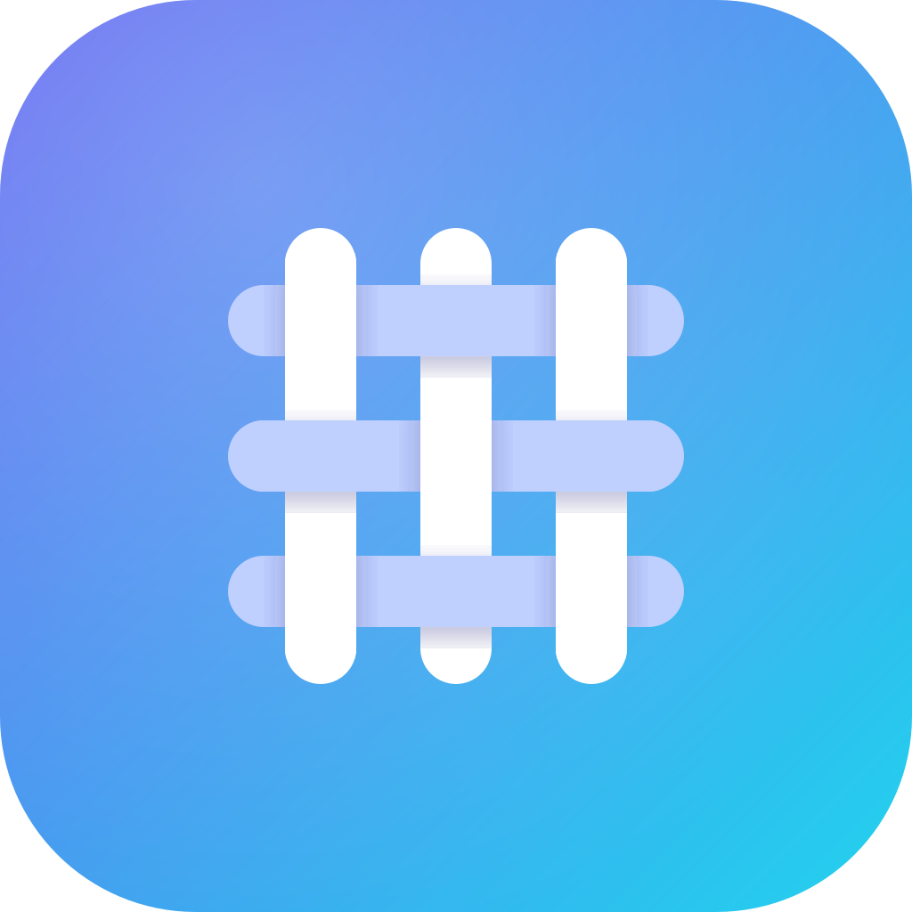

<p align="center"></p>

# Loom UI

Accessible, beautifully designed **Angular** components — standalone, signal-based, built on the CDK and Tailwind v4. Copy them into your app and own the code, or install the package. Every component is available as a **directive** (`<button uiButton>`) *and* as a **custom element** (`<ui-button>`).

> Loom UI is an independent project **inspired by [shadcn/ui](https://ui.shadcn.com)** (MIT). It is not affiliated with or endorsed by shadcn/ui or Vercel. See [NOTICE.md](NOTICE.md).

## Install

```bash
# copy components into your project (you own the code)
npx @loomui-ng/cli init
npx @loomui-ng/cli add button dialog data-table

# or use the package
npm install @loomui-ng/ui lucide
```

```html
<ui-button variant="outline">Directive or element, your choice</ui-button>
<button uiButton variant="outline">Same component</button>
```

## What's inside
- **64 components** (Button, Dialog, Data Table with TanStack Table, Calendar, Chart, Sidebar, Command, …) with behavior specs and manual test checklists — `docs/`.
- **Lucide icons** (`<ui-icon>`, `<svg uiIcon>`) and an icon browser in the showcase.
- **Dark mode, RTL, accent presets**, View-Transition theme switching, command palette, live playground.
- **Custom elements** for all components, with a shared host directive restoring roles, keyboard activation and `disabled`.

## Repository layout
| Path | What |
|---|---|
| `libs/ui` | the library (`@loomui-ng/ui`, one secondary entry point per component) — see its README |
| `packages/loomui-cli` | the `loomui` copy-in CLI and its registry |
| `projects/playground` | the showcase app (landing, component pages, icons, themes, elements) |
| `docs` | behavior specs, manual test checklists, final report |
| `tools` | generators (class strings from captured evidence, docs, registry, element aliases) |

## Develop
```bash
npm install
ng serve playground        # showcase
ng build ui                # package → dist/ui
npm run registry           # theme CSS, docs data and CLI registry
```
There are intentionally no automated tests: verification is manual, via `docs/manual-tests/`.

## License
MIT — see [LICENSE](LICENSE). Third-party notices: [NOTICE.md](NOTICE.md).
